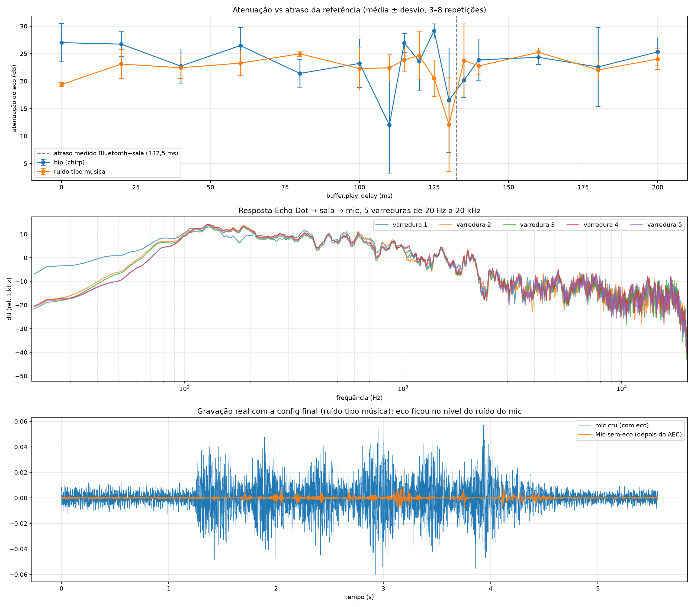

# omarchy-echo-dot-aec

Cancelamento de eco para quem usa um **alto-falante Bluetooth** (aqui, um Echo Dot) no Linux com **PipeWire** e conversa no Discord, Meet etc. ao mesmo tempo.



## O problema

A música sai do Echo Dot, o microfone do notebook capta e os seus amigos no Discord ouvem tudo de volta. A primeira "solução" era só um atraso fixo de 50 ms, que não resolvia.

## A solução

- Um processo PipeWire **nativo** com `libpipewire-module-echo-cancel` + `aec/libspa-aec-webrtc` (WebRTC AEC3).
- O som vai **direto** para o Bluetooth, sem loopback extra. Ou seja, nada de latência a mais no que você ouve.
- `buffer.play_delay` atrasa **só a cópia de referência** do cancelador (não o que você ouve), para alinhar com a latência do Bluetooth A2DP.
- **Calibração automática a cada conexão:** 3 varreduras curtas e baixas (~5 s) direto no alto-falante, correlação cruzada mic × monitor do sink, mediana → `play_delay = atraso medido − 12 ms` (limitado a 60–200 ms; se falhar, usa 120 ms). Log em `~/.local/share/echo-softvol/calib.log`. Desligue com `ECHO_CALIBRATE=0` ou force com `PLAY_DELAY=...`. Precisa de `numpy` num venv em `~/.local/share/echo-softvol/venv` com `calib/calib.py` copiado para lá.
- Opções do WebRTC: `noise_suppression` e `high_pass_filter` ligadas, `gain_control` desligada.
- Ficam criados dois dispositivos:
  - saída **"Echo"** (`echo_softvol`), com volume por software;
  - entrada **"Mic-sem-eco"** (`echo_mic`). Use esta no Discord.
- Um serviço systemd de usuário monta tudo sozinho quando o alto-falante conecta e desmonta quando desconecta.

Testado em: Omarchy (Arch), PipeWire 1.6.8, webrtc-audio-processing 1.3.

## Rodadas de ajuste (medidas reais, bip cronometrado + ruído tipo música)

| Rodada | Atenuação do eco |
|---|---|
| `pactl load-module module-echo-cancel` | 0,4–2,5 dB |
| Nativo, sem atraso | 5–15 dB |
| Nativo, +50 ms | 22 / 18,5 dB |
| **Nativo, +100 ms (escolhido)** | **24–31 / 12–23 dB**, eco abaixo do ruído do mic |
| Nativo, +200 ms | 8 / 12 dB |
| Nativo, +400 ms | 3,5 / 5 dB |

(bip / música). O gráfico de cima vem de uma gravação real do teste com música: microfone cru × microfone depois do AEC.


## Rodada 2: varredura 20 Hz–20 kHz + grade de atrasos (12/10/2026)

- **Atraso real Echo Dot (Bluetooth + sala → mic):** 5 varreduras log de 2 s, deconvolução → **132,5 ± 0,5 ms**. A calibração curta (0,5 s) dá 116–169 ms entre medições, por isso usa mediana de 3.
- **Resposta da sala:** forte em 100–300 Hz (+8 a +13 dB vs 1 kHz), cai −14 dB em 4 kHz e −20 dB em 16 kHz; abaixo de 40 Hz o Echo quase não toca.
- **Grade de `play_delay`** (0–200 ms de 20 em 20, fino de 5 em 5 entre 100 e 135; 3–8 repetições; média ± desvio, bip / música):

| play_delay | bip (dB) | música (dB) |
|---|---|---|
| 0 ms | 27,0 ± 3,5 | 19,4 ± 0,4 |
| 40 ms | 22,7 ± 3,1 | 22,4 ± 2,0 |
| 80 ms | 21,4 ± 2,5 | 25,0 ± 0,4 |
| 100 ms (antigo) | 23,2 ± 4,4 | 22,3 ± 3,9 |
| 115 ms | 26,9 ± 1,7 | 23,9 ± 2,2 |
| **120 ms (novo fixo)** | **23,6 ± 5,3** | **24,7 ± 4,3** |
| 125 ms | 29,1 ± 1,3 | 20,5 ± 3,3 |
| 130 ms | 16,5 ± 9,5 | 12,1 ± 8,5 |
| 160 ms | 24,3 ± 1,3 | 25,2 ± 0,8 |
| 200 ms | 25,7 ± 2,5 | 25,2 ± 1,5 |

**Conclusão honesta:** entre 0 e 200 ms a diferença fica dentro do ruído da medição (~20–27 dB). O AEC3 do WebRTC tem estimador de atraso interno e se vira sozinho nessa faixa; o ganho de trocar 100 → 120 ms é pequeno. O limite agora é físico: depois do AEC o eco já fica no nível do ruído do microfone, então a atenuação medida depende mais de quão alto o Echo toca do que do atraso.

## Instalação

```bash
git clone https://github.com/luishenrique-sss/omarchy-echo-dot-aec
cd omarchy-echo-dot-aec
bluetoothctl devices                        # anote o MAC do alto-falante
pactl list short sources | grep alsa_input  # anote o nome do microfone

mkdir -p ~/.local/bin ~/.config/systemd/user
cp bin/* ~/.local/bin/
cp systemd/echo-softvol-watcher.service ~/.config/systemd/user/
# edite BT_MAC (e, se quiser, MIC) em ~/.local/bin/echo-softvol-up e no .service
systemctl --user daemon-reload
systemctl --user enable --now echo-softvol-watcher.service
```

Depois, no Discord, escolha **Mic-sem-eco** como entrada. Como saída, use **Echo**.

Se a latência do seu alto-falante for outra, teste valores diferentes de atraso:
`PLAY_DELAY=2400/48000 ~/.local/bin/echo-softvol-up`, e meça com `tests/measure.py` (veja `tests/`).

## Reverter

```bash
systemctl --user disable --now echo-softvol-watcher.service
~/.local/bin/echo-softvol-up down
rm ~/.local/bin/echo-softvol-up ~/.local/bin/echo-softvol-watch ~/.config/systemd/user/echo-softvol-watcher.service
rm -rf ~/.config/echo-softvol
```

O guia completo está em [`docs/Guia_Eco_Alexa_Omarchy.pdf`](docs/Guia_Eco_Alexa_Omarchy.pdf).

---

### English summary

This setup fixes Bluetooth speaker echo on Linux/PipeWire. When music plays on a Bluetooth speaker (here an Echo Dot), the laptop mic picks it up and Discord friends hear it back. The fix is a standalone PipeWire instance running `module-echo-cancel` with the WebRTC AEC3 backend. Playback goes straight to the BT sink, and `buffer.play_delay` (auto-calibrated on each connect from a short sweep, measured BT+room delay 132.5 ± 0.5 ms, set to delay − 12 ms, fallback 120 ms) aligns only the AEC reference. A 0–200 ms delay grid showed differences within measurement noise (~20–27 dB), since AEC3 estimates delay internally. Measured echo attenuation is 24–31 dB on chirps and 12–23 dB on music, versus 0.4–2.5 dB with the plain `pactl` module. A systemd user service wires it up automatically on connect. Install and revert steps are above.

License: MIT.
