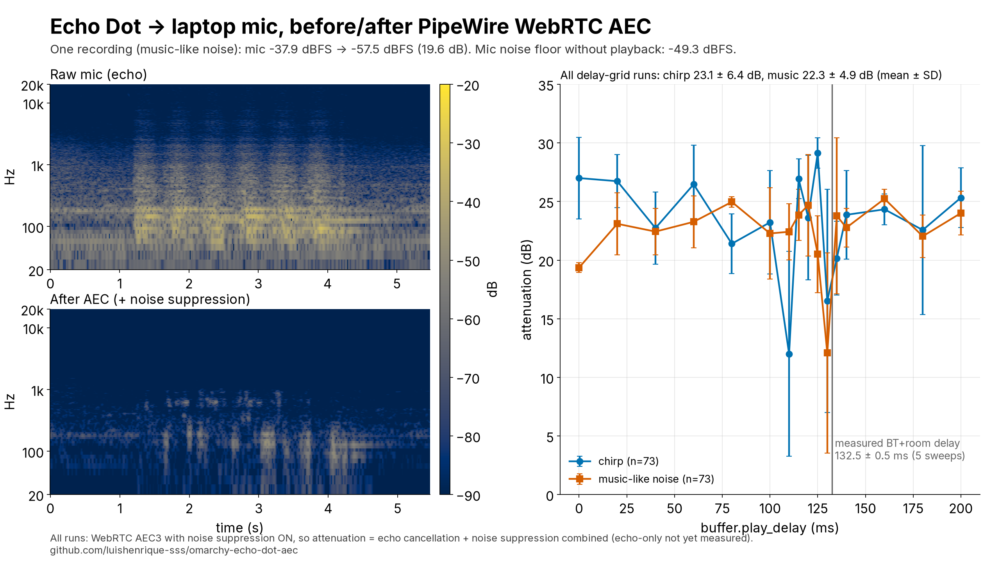

# omarchy-echo-dot-aec

Acoustic echo cancellation for a **Bluetooth speaker + laptop mic** on Linux with **PipeWire**, so people on a call (Discord, Meet…) don't hear your music back.



Full measurements: [docs/aec-graph.png](docs/aec-graph.png) · 20 s explainer video: [docs/aec-video.mp4](docs/aec-video.mp4)

## Problem

Audio played on a Bluetooth speaker (here an Amazon Echo Dot over A2DP) is picked up by the laptop mic and sent back into the call. A plain `pactl load-module module-echo-cancel` only removed 0.4–2.5 dB in our tests.

## How it works

- A standalone PipeWire process loads `libpipewire-module-echo-cancel` with the WebRTC backend (`aec/libspa-aec-webrtc`, AEC3).
- Playback goes straight to the Bluetooth sink (no extra loopback, no added listening latency).
- `buffer.play_delay` delays **only the AEC reference**, to line it up with the Bluetooth + room delay.
- WebRTC options: `noise_suppression` and `high_pass_filter` on, `gain_control` off.
- Two virtual devices: output **Echo** (`echo_softvol`) and input **Mic-sem-eco** (`echo_mic`, "mic without echo"). Pick that input in your call app.
- A systemd user service sets everything up when the speaker connects and tears it down when it disconnects. A `flock` prevents duplicate instances.

Tested on Omarchy (Arch), PipeWire 1.6.8, webrtc-audio-processing 1.3.

## Install

```bash
git clone https://github.com/luishenrique-sss/omarchy-echo-dot-aec
cd omarchy-echo-dot-aec
bluetoothctl devices                        # note the speaker MAC
pactl list short sources | grep alsa_input  # note the mic name (optional)

mkdir -p ~/.local/bin ~/.config/systemd/user
cp bin/* ~/.local/bin/
cp systemd/echo-softvol-watcher.service ~/.config/systemd/user/
# set BT_MAC (and optionally MIC) in ~/.local/bin/echo-softvol-up and the .service
systemctl --user daemon-reload
systemctl --user enable --now echo-softvol-watcher.service
```

## Calibration and timing

On each connect the script plays 3 short, quiet sweeps (~5 s total) on the speaker. It cross-correlates the mic with the sink monitor and sets `play_delay = median measured delay − 12 ms`, clamped to 60–200 ms. If that fails, it falls back to 120 ms. Results are logged to `~/.local/share/echo-softvol/calib.log`.

```bash
mkdir -p ~/.local/share/echo-softvol && cp calib/calib.py ~/.local/share/echo-softvol/
uv venv ~/.local/share/echo-softvol/venv && uv pip install --python ~/.local/share/echo-softvol/venv/bin/python numpy
```

Skip calibration with `ECHO_CALIBRATE=0`, or force a value with `PLAY_DELAY=5760/48000` (120 ms).

Measured timing on this setup:
- Bluetooth + room delay from 5 log sweeps: **132.5 ± 0.5 ms** (deconvolution).
- The short on-connect calibration reads 116–169 ms across single runs, so it uses the median of 3.
- On-connect calibration: ~5 s (3 quiet sweeps).
- Full benchmark (`tests/sweep.py` + `tests/grid.sh`): ~6 s per measurement; 151 measurements took ~16 min.
- CPU: the AEC PipeWire process (WebRTC AEC3 + noise suppression, 48 kHz) uses ~25–30% of one core (`top`, 3 samples), ~0.1% RAM (15 MB RSS).
- All numbers measured on one machine (Intel i5-13450HX, 16 threads, Omarchy). Expect different values elsewhere.

## Results

Measured with `tests/sweep.py` and `tests/grid.sh` (chirp and music-like noise, `buffer.play_delay` 0–200 ms):

| | mean ± SD | median | n |
|---|---|---|---|
| chirp | 23.1 ± 6.4 dB | 25.0 dB | 73 |
| music-like noise | 22.3 ± 4.9 dB | 23.2 dB | 73 |

- Between 0 and 200 ms the delay setting made no difference larger than the run-to-run spread. AEC3 estimates the delay internally.
- In the recording shown above, the mic level went from −37.9 dBFS to −57.5 dBFS (19.6 dB). The mic noise floor without playback was −49.3 dBFS.

**Caveat:** noise suppression was **on** in all runs, so these numbers are echo cancellation **plus** noise suppression. Echo-only attenuation has not been measured yet.

## Revert

```bash
systemctl --user disable --now echo-softvol-watcher.service
~/.local/bin/echo-softvol-up down
rm ~/.local/bin/echo-softvol-up ~/.local/bin/echo-softvol-watch ~/.config/systemd/user/echo-softvol-watcher.service
rm -rf ~/.config/echo-softvol ~/.local/share/echo-softvol
```

License: MIT.
